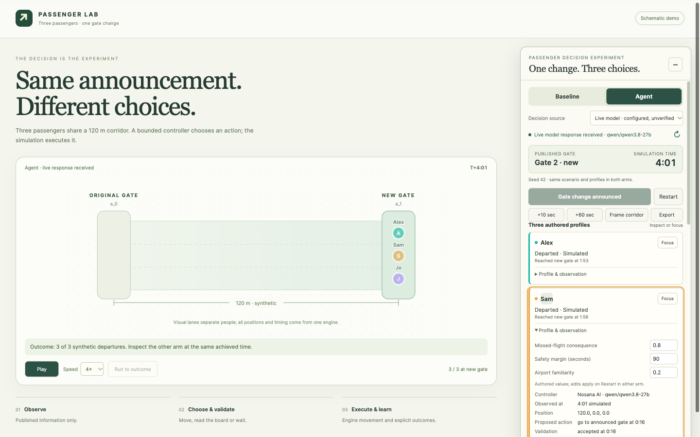
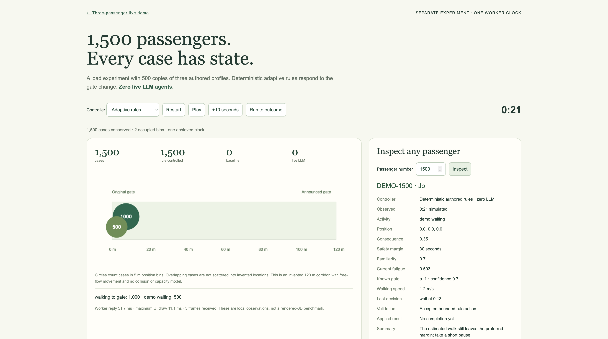

# Three passengers, one gate change

An inspectable passenger decision experiment: three authored profiles hear the same announcement, choose a bounded action, and receive an engine outcome. Compare the existing automatic baseline with an authored deterministic policy, fresh Nosana inference, or a clearly labeled recording replay.

This public reproduction uses an invented **120 m corridor**. The separate local HIA 3D demo uses furnished A3 scenery; its airport assets, historical datasets and staging geometry are excluded. These are software experiments, not calibrated passenger behavior.



## Run

Python 3.10+ and a modern browser; no build or npm install is needed for the browser demo. Node 22+ runs the tests. The optional Daytona command-line runner has its own SDK dependency.

```sh
python3 -B server.py --port 58741
```

Open **http://127.0.0.1:58741/** on that computer. This is a loopback preview, not a public deployment.

- **Recorded Nosana replay** reproduces the included real decisions without a new inference call. It restores the recording's profiles.
- **Deterministic demo policy** uses explicitly authored rules; no model is called.
- **Live model** requires your own authorized server-side configuration. Successful responses and fallbacks are labeled separately.
- Click **Run gate change**, then **Play** or **Run to outcome**. Click a passenger name or marker to inspect its profile, observed state, proposal, validation, result and timestamps.
- Edit consequence sensitivity, safety margin or familiarity, then **Restart**. Edits affect the next run; they never rewrite an in-flight observation. Both comparison arms must use matching inputs.
- Choose **Baseline** and run to the same achieved time. No agent improvement is presumed.

## Verified sponsor roles

**Nosana supplies bounded decisions.** The included [live recording](fixtures/nosana-live-run.json) contains four accepted responses from `qwen/qwen3.8-27b`, zero fallbacks: Alex and Jo went to the announced gate; Sam read the board, received completion, then went. Arrivals were113/116/113s, with three synthetic departures at241s. Fresh model decisions can differ; seed42 controls the engine, not remote inference. Brief declared summaries are not internal thought traces.

**Daytona executes reproducible experiments.** A real sandbox replayed those recorded actions through the pinned engine, matching local and original arrivals/outcomes. It performed no fresh model inference and was deleted after verification. See the [receipt](daytona/evidence/daytona-run.json), [source record](daytona/evidence/source-record.json), [minimal trace](daytona/evidence/recorded-trace.json), and [runner instructions](daytona/README.md). The local UI links to the rendered evidence report.

## Optional 1,500-passenger scale view

Open **http://127.0.0.1:58741/scale-lab/**. A separate browser worker runs1,500 stateful rule-controlled cases,500 copies of each authored profile, with **zero live LLM agents**. Its visualization displays counted position bins, not1,500 independently rendered bodies. Select any ID throughDEMO-1500; density and inspector share the same achieved clock. Play/pause, reset, baseline and final outcomes were browser-checked. No crowd collisions, empirical behavior or safe-capacity claim is made.



## Live configuration and bounds

The proxy supports a provider-neutral JSON endpoint or OpenAI-compatible chat completions. Credentials stay server-side and are absent from this repo. See [PROVIDER-CONTRACT.md](PROVIDER-CONTRACT.md) for protected configuration fields, action schema and local ledger flags. [Nosana's documentation](https://learn.nosana.com/llm/) explains account authorization, current served models and token billing.

For the verified selected Nosana model, use the optional private persistent usage ledger across all preview processes. It retains a30-attempt cap, conservative missing-usage reservations and a$9 local estimated-spend guard across restarts. A new ledger needs an explicit reserve for earlier calls. It is not the provider's account balance or a provider-enforced billing cap. Never commit the configuration or ledger.

The engine holds simulated time while a live decision is pending. Requests have a40-second upstream timeout and1,024-token output limit. Invalid, missing or timed-out responses produce explicit deterministic fallback. Responses cannot execute code or supply arbitrary destinations. Recording replay does not require credentials or network access to a model.

## Verification

```sh
node --test tests/gate-agent.test.mjs
python3 -B -m unittest discover -s tests -p 'test_server.py' -q
node --test daytona/tests/*.test.mjs
node --test web/scale-lab/tests/*.mjs
```

16 controller tests,32 proxy tests,8 Daytona lifecycle/replay tests and11 scale tests pass. Tests cover fair inputs, real movement, action completion and redecision, invalid actions, missing endpoints, timeouts, reset/stale replies, bounded waits, published-only observations, profile edits, recorded replay and resource invariants. Proxy tests use mocks/local listeners; the separately recorded live evidence identifies real external calls.

See [REPLAY-CONTRACT.md](REPLAY-CONTRACT.md), [INSPECTOR-CONTRACT.md](INSPECTOR-CONTRACT.md), [AUDIT.md](AUDIT.md), [NOTICE.md](NOTICE.md) and [EXPORT-MANIFEST.json](EXPORT-MANIFEST.json). The Daytona vendor files remain pinned to the exact revision executed in its receipt; subsequent browser replay/UI additions do not rewrite that historical evidence.

No new license grant is added. Public review access does not grant rights to the separate airport project, assets, brands or third-party material.
