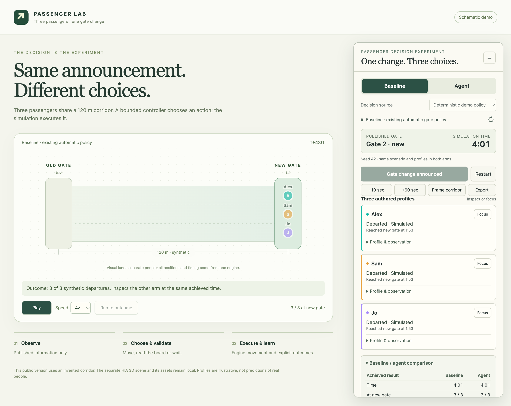

# Three passengers, one gate change

A small, inspectable passenger decision experiment. Three authored profiles receive the same gate announcement. A baseline reroutes automatically; agent mode chooses among `go_to_announced_gate`, `read_board` and a bounded `wait`. The existing event engine executes each accepted action and returns its outcome.

This public version uses a new **synthetic 120 m corridor**, rendered with SVG. The separate HIA 3D scene, airport datasets and visual assets are not included. It is not a calibrated model of real passengers or airport operations.



## Run locally

Requirements: Python 3.10+ and a modern browser. Node.js 22+ is needed only for the JavaScript tests. There are no npm dependencies or build steps.

```sh
python3 -B server.py --port 58741
```

Open **http://127.0.0.1:58741/** on the same computer. The server is deliberately loopback-only; this address is not a public deployment.

1. Keep **Agent → Deterministic demo policy** selected and click **Run gate change**.
2. Click **Play** or **Run to outcome**. Inspect each passenger and the decision/action log.
3. Switch to **Baseline**, which resets the same inputs. Run to the same achieved time to compare the retained results.
4. Edit profile values and press **Restart** to create a new run. Both arms must use matching inputs for a controlled comparison.

The default deterministic policy produces a direct walk, a board check followed by walking, and a short wait followed by walking. Those differences are explicitly authored rules, not live model inference. Baseline and mock agent runs both achieve three synthetic departures in the default scenario; no improvement is presumed.

## Optional live inference

No credential is included or required for deterministic mode. The server supports a provider-neutral JSON endpoint and an OpenAI-compatible endpoint. Configuration is held server-side; browser requests never contain a provider credential. See [PROVIDER-CONTRACT.md](PROVIDER-CONTRACT.md) for request/response fields and configuration names.

Nosana hosted inference is one optional provider, with an OpenAI-compatible `/v1/chat/completions` endpoint and available model names from `/v1/models`. A user's own authorized account, inference credential, available model and credits are needed. See [Nosana's hosted inference documentation](https://learn.nosana.com/llm/). This repository does not create accounts, buy credits, deploy GPU jobs or claim sponsor integration is configured.

“Configured” is not proof of connectivity. The interface reports successful live responses, missing configuration, invalid actions and deterministic fallbacks separately. Declared decision summaries are displayed explanations, not evidence of internal model reasoning.

## Test

```sh
node --test tests/gate-agent.test.mjs
python3 -B -m unittest discover -s tests -p 'test_server.py' -v
```

Controller tests cover equal initial inputs, real movement following decisions, redecision after action results, repeated announcements, invalid actions, missing endpoints, timeouts, stale runs and replies, bounded waits, published-information observations and case/resource invariants. Proxy tests use mocks and temporary loopback servers, not external services.

The simulation owns one clock. It pauses while a model decision is pending. Responses cannot execute code or supply arbitrary destinations. The controller validates action shape, allowed actions, time bounds and run/request identity before execution.

## Source boundary

The controller and three underlying engine modules are copied unchanged from the isolated local demo. A new `holding-layout.js` adapter exposes semantic positions only, replacing the airport's display layouts. A new three-node graph supplies the invented corridor. See [NOTICE.md](NOTICE.md), [EXPORT-MANIFEST.json](EXPORT-MANIFEST.json) and [AUDIT.md](AUDIT.md).

No licence grant is added by this export. Existing notices remain in the retained source. Public availability for review should not be read as a blanket licence for the separate airport project, its assets, brands or third-party material.
